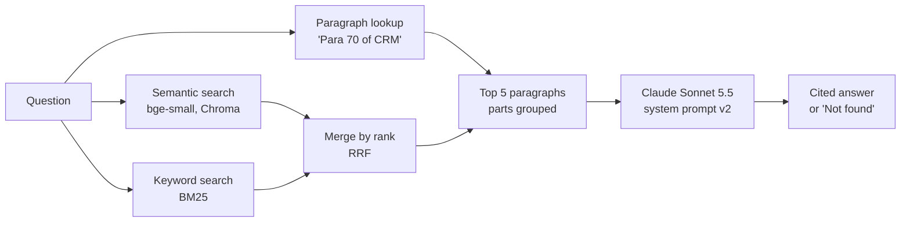

# Credit Assist: cited answers from RBI credit directions

A question-answering assistant for bank branch credit staff. It answers from three public RBI Master Directions, cites the paragraph behind every claim, and says "Not found in the provided documents." when the answer isn't there.

> Prototype, built as an AI product portfolio project. Not legal or regulatory advice: always verify against the official RBI document.

## The problem

Branch credit and operations staff often need one specific rule (an LTV ceiling, a reporting deadline, a valuation requirement) while a customer or a file is waiting. The rules sit in long, frequently amended Master Directions; the Credit Facilities direction alone runs to over 150 pages, with paragraph numbers like 219ZE. Searching the PDF is slow, and a wrong reading has compliance consequences.

## What it does

- Answers in under 150 words, citing every claim as `[Credit Facilities, Para 44]`.
- Refuses when the answer isn't in the loaded documents, instead of answering from general knowledge.
- Compares figures with mandatory limits ("90.3% exceeds the 90% ceiling") and shows calculation steps, but never makes a sanction decision.
- Shows the exact paragraphs it was given, so the user can check the answer.

Corpus: RBI (Commercial Banks) Credit Facilities, Credit Information Reporting and Credit Risk Management Directions, 2025 (618 paragraphs). The sidebar shows each direction's "updated as on" date.

## Results (Week 3)

Hand-graded. Model `claude-sonnet-5-5`, effort medium, hybrid retrieval, system prompt v2.

| Metric | Unseen questions (holdout, 15) | Tuned test set (40) | PRD target |
|---|---|---|---|
| Correct (partial = 0.5) | **83%** | 94% | ≥ 85% |
| Correct refusals (out-of-corpus) | 2/2 | 8/8 | — |
| Citation accuracy | 100% | 100% | ≥ 90% |
| Hallucination rate | 0% | 2.5% (1 minor) | ≤ 5% |
| Latency, median / p95 | 2.8s / 4.1s | 3.4s / 7.2s | p95 < 8s |
| Cost per 1,000 queries | — | about $8.65 | < ₹1 per query |

The headline is **83% on unseen questions**. The 94% is on the questions used to find and fix problems, so it is optimistic. Both samples are small: one holdout question moves the score by 6.7 points. Cost uses Anthropic's list prices as checked on 29 Oct 2026 (`scripts/cost_report.py`).

How the score moved, one change at a time ([full log](docs/eval_log.md)):

| Iteration | Change | Correct (40 q) |
|---|---|---|
| Baseline | Semantic search, prompt v1 | 82% |
| 1 | + keyword search and paragraph lookup (hybrid) | 91% |
| 2 | Prompt v2: plain limit breaches, scope check before flagging conflicts | 94% |
| Holdout | 15 unseen questions, nothing changed | 83% |

All three holdout misses were retrieval failures, not model errors.

## How it works



Ingestion (`ingest.py` → `clean.py` → `chunk.py` → `embed_store.py`) extracts the PDFs, applies hand-verified table and text fixes, and stores one chunk per paragraph with its citation. Every choice and its trade-off is explained in [docs/design_decisions.md](docs/design_decisions.md).

## Run it

Requires Python 3.11 and an Anthropic API key.

```
conda create -n rbi-rag python=3.11
conda activate rbi-rag
pip install -r requirements.txt
```

1. Create `.env` in the repo root with `ANTHROPIC_API_KEY=...` (and `ANTHROPIC_WORKSPACE_ID=...` if your key needs it). Check it with `python scripts/check_api_key.py`.
2. Download the three credit PDFs listed in `data/manifest.csv` into `data/raw/`.
3. Build the index (no API calls):
   ```
   python scripts/ingest.py
   python scripts/clean.py
   python scripts/chunk.py
   python scripts/embed_store.py
   ```
4. Ask questions: `streamlit run scripts/app.py`, or `python scripts/answer.py "What is the maximum LTV for a gold loan of 4 lakh?"`

Evaluate (see [tests/README.md](tests/README.md)):

```
python scripts/run_eval.py --retrieval-only                 # free
python scripts/run_eval.py --label my_run                   # about 40 API calls, then grade in Excel
python scripts/score_eval.py results/eval_my_run_<date>.csv
```

## Repository layout

| Path | Contents |
|---|---|
| `scripts/` | Pipeline, app, evaluation and reporting scripts |
| `prompts/` | System prompts v1–v3 with change logs |
| `tests/` | Test sets: v1 (40), holdout (15), fresh (16), real-question template |
| `results/` | Graded evaluation runs and summaries |
| `docs/` | Evaluation log, design decisions, user evidence plan |
| `data/manifest.csv` | Source documents. `data/overrides/` holds hand-verified fixes. PDFs, processed text and the vector store are not committed |

## Known limits

- **Small, self-written test sets.** The questions were written from the documents and graded by one person. Next: real staff phrasing ([plan](docs/user_evidence_plan.md)) and a blind second grader (`scripts/second_grader.py`).
- **Wording gaps.** "Maximum" vs "shall not exceed" and "renewed" vs "renewal" still cause misses.
- **Narrow corpus.** Only 3 of the 16 directions in the manifest are indexed; KYC, IRAC and the others are refused.
- **Single-user prototype.** No login, no access control, and questions are logged locally to `logs/qa_log.csv`.

## Keeping the corpus current

RBI amends Master Directions from time to time. The current process is manual:

1. Monthly, open each indexed direction on rbi.org.in and compare its "updated as on" date with `last_updated` in `data/manifest.csv`.
2. If it changed: download the new PDF into `data/raw/`, update the manifest and the `updated_as_on` date in `scripts/chunk.py`, check that the hand-entered tables in `data/overrides/` still match the PDF, then rebuild the index (step 3 above).
3. Re-run the evaluation and log the result before using the updated corpus.

## Data policy

Public RBI Master Directions only, listed in `data/manifest.csv`. Never used: internal bank documents, intranet content, internal circulars, process notes, or any customer data, including anonymised data. Source PDFs are not committed.

## Status

- Weeks 1–3 complete: setup, prototype (CLI + Streamlit), 40-question evaluation with two iterations, and a holdout check.
- Week 4 (next): model comparison (Haiku / Sonnet / Opus), fresh-set evaluation of neighbour paragraphs and prompt v3, real-question set.

License: see `LICENSE`.
